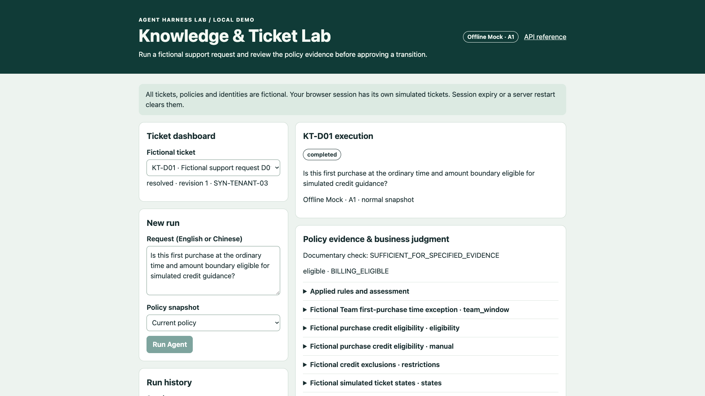
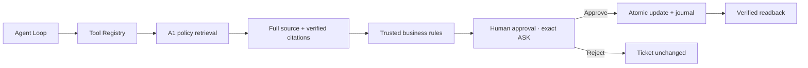

# Knowledge & Ticket AI Agent

A local demo of an AI agent that finds policy evidence, asks for approval, and verifies the result of a simulated support-ticket update.

[](https://github.com/ylii0950-png/agent-harness-portfolio/releases/download/v1.0.0/demo.mp4)

[**Watch the full demo (MP4)**](https://github.com/ylii0950-png/agent-harness-portfolio/releases/download/v1.0.0/demo.mp4) · [Animated preview (GIF)](https://github.com/ylii0950-png/agent-harness-portfolio/releases/download/v1.0.0/demo.gif)

The recording uses the real FastAPI dashboard and fictional tickets. The **deterministic Offline Mock** provider drives the workflow, including the tool calls, approval gate, and ticket updates.

## What the demo shows

| Scenario | Result |
| --- | --- |
| **KT-D01 · Approve** | The agent retrieves policy evidence. The controller verifies source citations and requests approval for the exact WRITE. The ticket resolves at revision 1, with one journal commit and verified readback. |
| **KT-D08 · Reject** | A Chinese request reaches the same approval gate. Rejection returns `permission_denied`. The ticket stays open at revision 0 with zero commits. |

The Python Harness also provides planning, scoped subagents, lazy Skills, context compaction, tool budgets, and tracing. MCP stdio, SQLite memory, and constrained Docker execution are optional.

## Architecture



See the [architecture and trust boundaries](docs/architecture.md) and [local security model](docs/security.md).

## Quick start

Install [uv](https://docs.astral.sh/uv/), then run these commands from the repository root.

```sh
uv sync --project examples/knowledge_ticket_agent --locked --no-editable --extra web --python 3.12
uv run --project examples/knowledge_ticket_agent --no-sync lqd-web
```

Open [the dashboard](http://127.0.0.1:8000/). Choose **KT-D01**, then **Run Agent → Approve**. Try **KT-D08** with **Reject**. The [local API reference](http://127.0.0.1:8000/docs) describes request and response schemas. The [Demo guide](examples/knowledge_ticket_agent/README.md#browser-demo-and-http-api) covers other scenarios and API usage.

Run the same fictional application from the command line.

```sh
uv run --project examples/knowledge_ticket_agent --no-sync lqd-agent-demo --json
```

## Tech stack and tests

- **Runtime** uses Python 3.11 or 3.12, a Python tool registry, and deterministic A1 retrieval with canonical source verification.
- **Web** uses FastAPI, Uvicorn, and locally served JavaScript and CSS. In-memory sessions isolate simulated tickets and bind approval to the exact pending write.
- **Verification** includes offline Core and Demo regression suites. The [reproduction guide](docs/reproduce.md) covers tests, package builds, lint, and type checks. The [CI workflow](.github/workflows/ci.yml) defines the macOS and Linux matrix.

## Scope and limitations

This is a loopback-only, single-process demo with temporary session data. The default flow uses no real model requests or credentials. A1 is the supported default. Optional local R1 and source-assertion verification are experimental within the documented fixture domain. See the [evidence notes](docs/evidence-recovery.md).

**Portfolio MVP Engineering PASS** · **Independent M2 Formal FAIL (consumed)** · **M5 Formal NOT_RUN** · **Original Final Release BLOCKED**. See the [historical release status](docs/release-status.md) for scope and measurements.

## License and attribution

MIT. This independent implementation was informed by [shareAI-lab/learn-claude-code](https://github.com/shareAI-lab/learn-claude-code). See the [project license](LICENSE), [upstream MIT license](licenses/learn-claude-code-MIT.txt), and [reference commit](docs/upstream.md).
