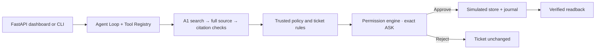

# agent-harness-lab

A Python agent runtime with a local FastAPI dashboard and a fictional Knowledge & Ticket application. Run the demo to see how an agent finds policy evidence, asks for approval, and verifies the result of a simulated ticket update.

## Quick start

Install [uv](https://docs.astral.sh/uv/) and run these commands from the repository root. The project supports Python 3.11 and 3.12. The demo uses deterministic Mock responses and A1 retrieval.

```sh
uv sync --project examples/knowledge_ticket_agent --locked --no-editable --extra web --python 3.12
uv run --project examples/knowledge_ticket_agent --no-sync lqd-web
```

Open [the dashboard](http://127.0.0.1:8000/) and try these two flows.

| Ticket | Action | What to look for |
| --- | --- | --- |
| **KT-D01** | Run Agent → Approve | Review source citations and the pending WRITE. The ticket resolves at revision 1 with one commit and verified readback. |
| **KT-D08** | Run Agent → Reject | The permission engine denies the WRITE. The ticket stays open at revision 0 with zero commits. |

The local [API reference](http://127.0.0.1:8000/docs) shows request and response schemas. The [Demo guide](examples/knowledge_ticket_agent/README.md#browser-demo-and-http-api) covers additional scenarios and HTTP examples.

## Architecture



- **Core** provides tool calling, planning, scoped subagents, lazy Skills, context compaction, execution budgets and tracing. Optional extensions cover MCP stdio, SQLite memory and constrained Docker execution.
- **Knowledge & Ticket** adds deterministic policy retrieval, citation verification, bounded English/Chinese requests, business rules, journaled changes and readback.
- **Web** uses FastAPI, Uvicorn and browser assets served locally. Sessions isolate the in-memory tickets and bind each approval to the exact pending write.

See the [architecture](docs/architecture.md) and [security boundaries](docs/security.md).

## Command-line demo and tests

Run the fictional workflow from the same locked Demo environment.

```sh
uv run --project examples/knowledge_ticket_agent --no-sync lqd-agent-demo --json
```

The [reproduction guide](docs/reproduce.md) covers the two-wheel install, the standalone Core demo, the Core/Demo regression suites, lint, type checks and builds. The [CI workflow](.github/workflows/ci.yml) defines the macOS/Linux and Python 3.11/3.12 matrix. See [contributing](AGENTS.md) for the development checks.

## Scope and release status

The dashboard is a loopback-only, single-process demo. Tickets and decisions are fictional, session data is temporary, and the default run uses no model credentials. A1 is the supported demo profile. Optional local R1 and source-assertion verification are experimental within the documented domain. See the [evidence notes](docs/evidence-recovery.md).

**Portfolio MVP Engineering PASS**, **Independent M2 Formal FAIL (consumed)**, **M5 Formal NOT_RUN**, and **original Final Release BLOCKED**. The [release status](docs/release-status.md) records the scope and historical measurements.

## License

MIT. This independent implementation was informed by [shareAI-lab/learn-claude-code](https://github.com/shareAI-lab/learn-claude-code). See the [project license](LICENSE), [upstream MIT license](licenses/learn-claude-code-MIT.txt) and [reference commit](docs/upstream.md).
