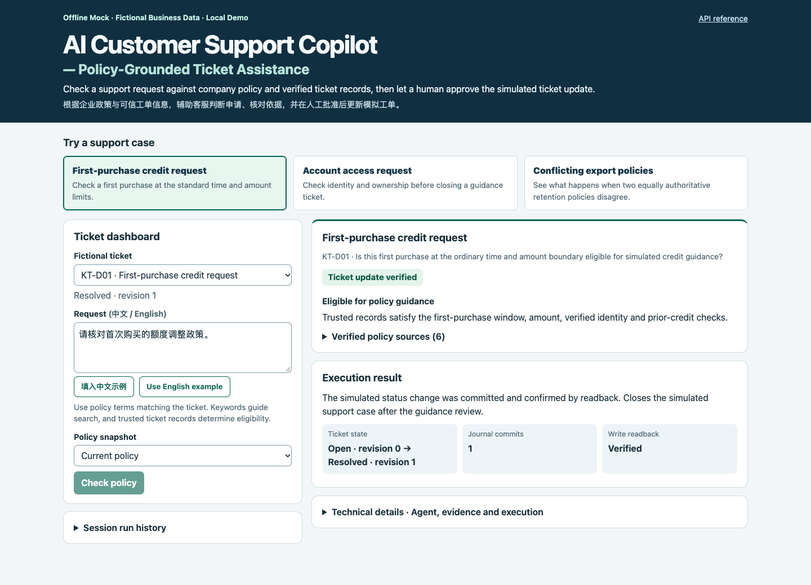
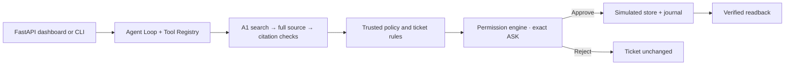

# AI Customer Support Copilot

**Policy-Grounded Ticket Assistance** · Python AI Agent portfolio

A support specialist needs to decide whether a customer qualifies for first-purchase credit guidance. The copilot finds and verifies the applicable policy, checks trusted ticket records, and presents a proposed ticket update for human approval. After approval it commits the simulated update once and reads back the new state.

**Offline Mock · Fictional Business Data · Local Demo.** The browser accepts bounded Chinese and English policy terms for purchase credit, account access, and workspace export. Scripted Mock tool calls drive the Agent Loop, A1 performs lexical retrieval, and deterministic rules assess the fixture records. The only write is to the local simulated ticket store.

[Watch the 25-second demo (MP4)](docs/media/support-demo.mp4) · [Animated GIF](docs/media/support-demo.gif)



| Try a support case | What happens |
| --- | --- |
| **First-purchase credit** · KT-D01 | The trusted records qualify for guidance. **Approve ticket update** changes the simulated case from **Open, revision 0** to **Resolved, revision 1**. The page shows one commit and verified readback. |
| **Account access** · KT-D08 | The verified owner qualifies for access guidance. **Reject update** leaves the ticket open with zero commits. |
| **Conflicting export policies** · KT-D10 | The selected fictional snapshot has contradictory retention rules. The evidence check blocks the update before approval. |

Each case includes clickable Chinese and English examples. **Technical details** shows real tool calls, ranked retrieval, original policy quotes, rule evaluation, approval binding, journal and readback. **Tech stack** uses Python 3.11/3.12, FastAPI, Uvicorn, and vanilla HTML/CSS/JavaScript.

## Quick start

Install [uv](https://docs.astral.sh/uv/) and run from the repository root.

```sh
uv sync --project examples/knowledge_ticket_agent --locked --no-editable --extra web --python 3.12
uv run --project examples/knowledge_ticket_agent --no-sync lqd-web
```

Open the local dashboard, select a case, fill a language example, and choose **Check policy**. Review the policy judgment before deciding on a proposed update. [Dashboard](http://127.0.0.1:8000/) · [API reference](http://127.0.0.1:8000/docs) · [Demo guide](examples/knowledge_ticket_agent/README.md#browser-demo-and-http-api)

## Architecture



- **Core** provides tool calling, planning, scoped subagents, lazy Skills, context compaction, execution budgets and tracing. Optional extensions cover MCP stdio, SQLite memory and constrained Docker execution.
- **Knowledge & Ticket** adds deterministic policy retrieval, citation verification, bounded English/Chinese requests, business rules, journaled changes and readback.
- **Web** uses FastAPI, Uvicorn and browser assets served locally. Sessions isolate the in-memory tickets and bind each approval to the exact pending write.

See the [architecture](docs/architecture.md) and [security boundaries](docs/security.md).

## Command-line demo and tests

Run the fictional workflow from the same locked Demo environment.

```sh
uv run --project examples/knowledge_ticket_agent --no-sync lqd-agent-demo --json
```

The [reproduction guide](docs/reproduce.md) covers the two-wheel install, the standalone Core demo, the Core/Demo regression suites, lint, type checks and builds. The [CI workflow](.github/workflows/ci.yml) defines the macOS/Linux and Python 3.11/3.12 matrix. See [contributing](AGENTS.md) for the development checks.

## Scope and release status

The dashboard is a loopback-only, single-process demo. Tickets and decisions are fictional, session data is temporary, and the default run uses no model credentials. A1 is the supported demo profile. Optional local R1 and source-assertion verification are experimental within the documented domain. See the [evidence notes](docs/evidence-recovery.md).

**Portfolio MVP Engineering PASS**, **Independent M2 Formal FAIL (consumed)**, **M5 Formal NOT_RUN**, and **original Final Release BLOCKED**. The [release status](docs/release-status.md) records the scope and historical measurements.

## License

MIT. This independent implementation was informed by [shareAI-lab/learn-claude-code](https://github.com/shareAI-lab/learn-claude-code). See the [project license](LICENSE), [upstream MIT license](licenses/learn-claude-code-MIT.txt) and [reference commit](docs/upstream.md).
