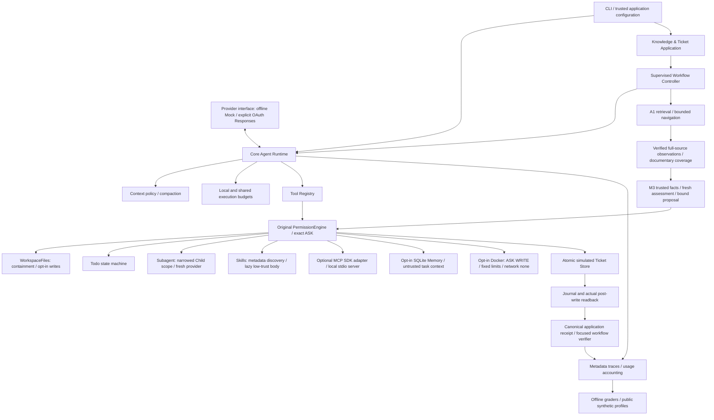

# Current architecture

The Portfolio MVP uses A1 search, full canonical policy reads, bounded
documentary coverage and trusted M3 facts. The exact ASK and simulated
transaction are independent of retrieval rank. Optional R1 and the versioned
source-assertion engine run in a bounded domain. The
[evidence recovery record](evidence-recovery.md) describes their measured DEV
behavior and the earlier public Challenge failure.

Required Core uses the Python standard library. Business code depends on public
Core interfaces; Core never imports ticket schemas, rules or data. Extensions
register tools on the existing Registry and use the original permission and
budget engines. There is one Core Agent loop.

MCP requires its pinned optional SDK; Memory uses SQLite in the standard library;
Docker requires a trusted local daemon and preloaded immutable image. None is
enabled merely by installing the base wheel. Configuring a stdio server starts
a same-user program, not an isolated process. Docker controls are separate from
WorkspaceFiles and do not weaken its checks.

In Mock business execution, scripted responses select real Parent tools;
the unchanged M4 grader checks actual calls, provenance, permissions and state.
In the supervised real workflow, the model selects initial searches and supplies
a structured action intent. The controller owns stage prerequisites, targeted
source acquisition, fresh M3 assessment, ASK, commit and verification. Controller
reads have explicit controller origin and are never counted as autonomous Parent
full reads. A receipt derives from observations and transactions, not model claims.
An unsupported optional model explanation remains visibly invalid.

A successful model response alone proves neither evidence completeness nor a
committed transition. Search hits, catalog metadata, Memory and MCP are not verified
Parent policy full reads or trusted business facts. No second permissive WRITE path.
FastAPI is deferred. See [boundaries and current acceptance](release-status.md).

## Runtime and evaluation entry points

| Path | Actual modules and responsibility |
| --- | --- |
| Core | `runtime.Agent` → `tools.ToolRegistry` → `permissions.PermissionEngine`; Workspace/Todo/Child/Skill/extension handlers reuse this dispatch |
| Mock product | `business_demo.run_ticket` / `run_request` → `DemoApplication` → Core Agent; `BusinessProvider` scripts feedback, not a second loop |
| Supervised workflow | `WorkflowController` uses Core Agent for search/intent, then `BusinessWorkflow` for M3, exact ASK and atomic TicketStore/readback |
| Shared retrieval | `retrieval_profiles.A1Retriever`; `bilingual.BilingualRetriever` adds the versioned finite query bridge; `quality_evidence` handles read-only acquisition |
| Business evaluation | `business_evaluation.run_public` → task-only `evaluation_runtime.execute_public_task` → unchanged `agent_grading.grade_run` → case/report checks |
| New independent M2/M5 | `formal_evaluation.FormalOperator` owns the exact release/claim; M2 delegates to `quality_formal`, M5 to the shared business runner |
| Structural validation | `acceptance_inputs` checks schemas/source mappings without ranking, execution or claiming |
| Historical M2F | `formal_operator`, `formal_scoring`, encrypted `formal_ledger.Ledger`; preserved for original protocol and saved-record recovery, never a new-run authority |

The separate public rehearsal ledger, historical encrypted M2F ledger and consumed
live journals have different storage/authorization protocols. Their similar names
do not make them interchangeable. Original retrieval candidates and CLI profiles
remain for reproducibility. Runtime and independent checks retain distinct source
proof; consolidating them would remove checks rather than just repetition.

## Optional experimental retrieval

`retrieval_vnext.VNextRetriever` reuses the original index, catalog, citation and
permission boundaries. `semantic_model.E5Encoder` supplies checksum-pinned offline
CPU vectors; only explicit preparation downloads assets. D ranks semantic vectors;
H combines bounded lexical candidates and evidence diversity. Trusted application
injection binds the exact index and propagates the selected method into actual
search tools. Default and frozen formal paths retain A1; the public opt-in runner
starts with the actual task query. Scores never grant business or write authority.

See the [fixed experiment and compatibility record](systematic-remediation.md).
Neither candidate passed the final public challenge promotion conditions. No
semantic dependency, model download or native inference is added to standard CI.

The subsequent opt-in `retrieval_structural.StructuralRetriever` exposes independent
channel membership and support/selection traces. Catalog eligibility precedes
`generate_candidates`; `_select_evidence` consumes candidates without authorizing
sources or writes. The original citation/documentary/ASK/atomic boundaries remain.
See [experimental retrieval and limits](evidence-recovery.md).
